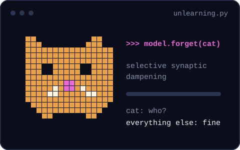

<picture>
  <source media="(prefers-reduced-motion: reduce)" srcset="assets/static/hero.svg">
  
</picture>

Founding Sacron, a startup working on fairness in AI systems and the data behind them.

Researching federated learning and machine unlearning, previously at Cambridge's CaMLSys lab and continuing at Georgia Tech.

  <picture>
    <source media="(prefers-reduced-motion: reduce)" srcset="assets/static/federated.svg">
    
  </picture>
  <picture>
    <source media="(prefers-reduced-motion: reduce)" srcset="assets/static/forget.svg">
    
  </picture>

[LinkedIn](https://www.linkedin.com/in/aryan-bhan-110734316/) · [Email](mailto:abhan7@gatech.edu)
