<picture>
  <source media="(prefers-reduced-motion: reduce)" srcset="assets/static/hero.svg">
  
</picture>

Co-Founding Sacron, a startup working on fairness in AI systems and the data behind them.

Researching Trustworthy ML, previously at Cambridge's CaMLSys lab and continuing at Georgia Tech.

  <picture>
    <source media="(prefers-reduced-motion: reduce)" srcset="assets/static/federated.svg">
    
  </picture>
  <picture>
    <source media="(prefers-reduced-motion: reduce)" srcset="assets/static/dampening.svg">
    
  </picture>

Built [Serve Analyzer](https://github.com/AryanB-07/Serve-Analyzer), a tennis serve coach. Upload a video and it tracks your pose frame by frame, scores your joint angles at each phase of the serve, and gives plain-English feedback. Working on releasing public beta version...

<a href="https://github.com/AryanB-07/Serve-Analyzer">
  <picture>
    <source media="(prefers-reduced-motion: reduce)" srcset="assets/static/serve.svg">
    
  </picture>
</a>

<picture>
  <source media="(prefers-reduced-motion: reduce)" srcset="assets/static/route.svg">
  
</picture>

[LinkedIn](https://www.linkedin.com/in/aryan-bhan-110734316/) · [Email](mailto:abhan7@gatech.edu)
