<picture>
  <source media="(prefers-reduced-motion: reduce)" srcset="assets/static/hero.svg">
  
</picture>

<picture>
  <source media="(prefers-reduced-motion: reduce)" srcset="assets/static/line-sacron.svg">
  
</picture>

<picture>
  <source media="(prefers-reduced-motion: reduce)" srcset="assets/static/trace.svg">
  
</picture>

<picture>
  <source media="(prefers-reduced-motion: reduce)" srcset="assets/static/line-research.svg">
  
</picture>

  <picture>
    <source media="(prefers-reduced-motion: reduce)" srcset="assets/static/federated.svg">
    
  </picture>
  <picture>
    <source media="(prefers-reduced-motion: reduce)" srcset="assets/static/dampening.svg">
    
  </picture>

<picture>
  <source media="(prefers-reduced-motion: reduce)" srcset="assets/static/line-serve.svg">
  
</picture>

<a href="https://github.com/AryanB-07/Serve-Analyzer">
  <picture>
    <source media="(prefers-reduced-motion: reduce)" srcset="assets/static/serve.svg">
    
  </picture>
</a>

<picture>
  <source media="(prefers-reduced-motion: reduce)" srcset="assets/static/line-home.svg">
  
</picture>

<picture>
  <source media="(prefers-reduced-motion: reduce)" srcset="assets/static/route.svg">
  
</picture>

[LinkedIn](https://www.linkedin.com/in/aryan-bhan-110734316/) · [Email](mailto:abhan7@gatech.edu)
